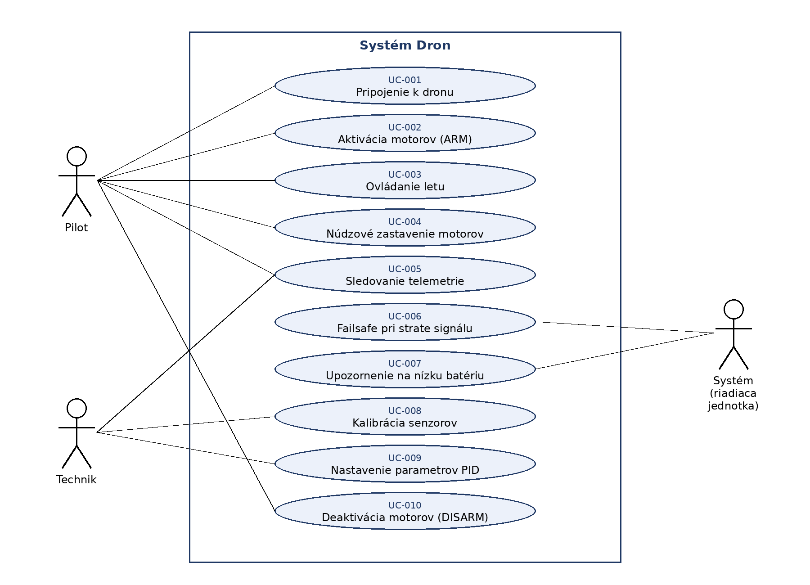

# Dron

Ročníkový projekt – kvadrokoptéra s riadiacou jednotkou ESP32, ovládaná webovou aplikáciou v mobilnom telefóne cez WiFi.

| | |
|---|---|
| **Trieda** | 3.BTL |
| **Softvér** | Marián Barcík |
| **Hardvér** | Radovan Kudri |

## Štruktúra projektu

| Priečinok | Obsah |
|---|---|
| [`01_POZIADAVKY`](01_POZIADAVKY) | Čo má systém robiť – požiadavky, role a prípady použitia |
| [`02_ANALYZA`](02_ANALYZA) | Ako funguje problematika, súčasný stav |
| [`03_NAVRH`](03_NAVRH) | Ako navrhneme riešenie |
| [`04_IMPLEMENTACIA`](04_IMPLEMENTACIA) | Zdrojové kódy a aplikácia |
| [`05_TESTOVANIE`](05_TESTOVANIE) | Overovanie správnosti |
| [`06_DOKUMENTACIA`](06_DOKUMENTACIA) | Návody a inštalácia |

## 01 Požiadavky

- [`poziadavky.xlsx`](01_POZIADAVKY/poziadavky.xlsx) – požiadavky na systém (hardvér, softvér, nefunkčné požiadavky) s prioritou a akceptačnými kritériami
- [`pripady-pouzitia/Role_a_pripady_pouzitia.docx`](01_POZIADAVKY/pripady-pouzitia/Role_a_pripady_pouzitia.docx) – role (Pilot, Technik, Systém), zoznam a diagram prípadov použitia
- [`pripady-pouzitia/UC-001` až `UC-010`](01_POZIADAVKY/pripady-pouzitia) – podrobné prípady použitia

